# Сноска — проверка документов по 152-ФЗ со сносками на закон

**Стек:** Python 3.13, FastAPI, Pydantic v2, SQLAlchemy 2 (async), PostgreSQL 18 + pgvector (RLS), Alembic, Dramatiq + Redis · Next.js 16, React 19, TypeScript, TanStack Query, next-intl, Radix · Keycloak 26.8 (организации, OIDC через BFF) · OpenAI-совместимый API моделей (OpenRouter: nemotron-3-super, эмбеддинги bge-m3) · Tesseract, pdfplumber, python-docx · Docker, Caddy, k6, Playwright, ffmpeg.

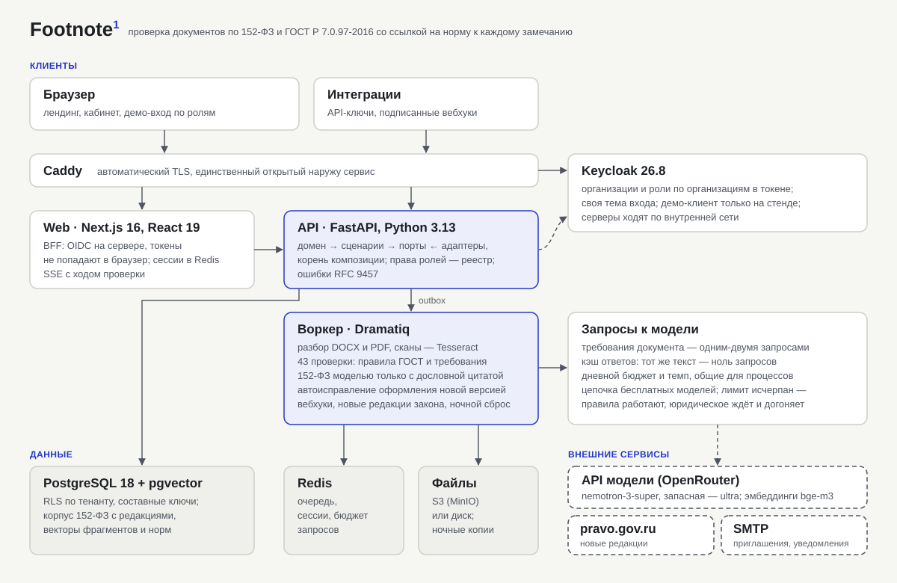

Видео (45–60 секунд, без звука): [1920×1080](video/snoska-1920x1080.mp4) · [1080×1920](video/snoska-1080x1920.mp4).

## Задача

Юристу компании, которая обрабатывает персональные данные, нужно держать в порядке политику, согласия, договоры поручения и приказы: требования 152-ФЗ и правила оформления по ГОСТ Р 7.0.97-2016. Ручная проверка документа — час-два на сверку с законом, а ответы «нейросети» без источника юрист принять не может: ошибку в сроке или основании обработки придётся объяснять Роскомнадзору.

Нужен сервис, который проверяет документ целиком и к каждому замечанию даёт сноску — статью, часть и пункт закона с цитатой, — работает для команды с ролями и не выдумывает.

## Решение

- **Проверка как документ со сносками.** Загруженный DOCX или PDF (скан тоже) разбирается в структуру; 43 проверки — данные, а не код: 15 правил оформления и 28 требований 152-ФЗ. Результат — лист документа с надстрочными номерами и карточками на полях: серьёзность, цитата нормы, как исправить, решение юриста.
- **Модель — только с опорой.** Для требования находятся фрагменты документа и положения закона из действующей редакции; модель отвечает по JSON-схеме, и ответ принимается, только если каждая цитата дословно есть в документе, а норма — одна из данных. Текст нормы в замечании берётся из корпуса, а не из ответа модели.
- **Автоисправление оформления** создаёт новую версию DOCX (поля, кегль, интервалы, даты) с журналом «было/стало»; оригинал не меняется.
- **«Спросить норму»** — ответ о 152-ФЗ только с цитатами и ссылками на пункты; если опоры нет, так и сказано.
- **Сервис вокруг проверки:** организации и роли в Keycloak, пространства, тарифы с леджером и атомарными лимитами, API-ключи и подписанные вебхуки, журнал аудита, еженедельная сверка с официальным порталом и письмо о новой редакции закона, консоль оператора платформы.
- **Демо и лендинг:** лендинг для гостей с записями настоящих экранов, вход в один клик по ролям на демо-стенде с ночным возвратом к исходным данным.

## Результат

- Качество измерено на эталонном наборе из 14 документов с размеченными нарушениями: юридические проверки — точность 100 %, полнота 84 %; правила оформления — полнота 100 %, точность 92 % ([quality.md](../quality.md)). Цифры показаны и в продукте, на странице «Как мы проверяем».
- Проверка типовой политики на 8 страниц с моделью — 45 секунд, в среднем по набору — 10 секунд; правила оформления — десятки миллисекунд.
- Нагрузочный тест: 42 запроса в секунду в четырёх потоках (список, отчёт, загрузка, проверка с ходом по SSE) — p95 36 мс, ошибок нет; один процесс API насыщается около 120 запросов в секунду ([performance.md](../performance.md)).
- Продакшен-сборка: образы без root с healthcheck, Docker Compose с Caddy и автоматическим TLS, миграции при выкатке, ночные резервные копии и проверенное восстановление ([deploy.md](../deploy.md)).
- Гейт CI: лимиты размера файлов и папок, ruff, mypy `--strict`, контракты слоёв import-linter, pytest с интеграционными тестами изоляции тенантов на настоящем PostgreSQL, tsc, ESLint, Stylelint, Prettier.

## Ключевые решения и почему

**Цитата обязательна.** Без контекста модель на вопрос о сроке прекращения обработки после отзыва согласия ответила «не позднее трёх рабочих дней», а ч. 5 ст. 21 152-ФЗ говорит о тридцати днях. С положением закона перед глазами та же модель ответила верно и процитировала норму. Поэтому сервис не принимает ни замечание, ни ответ без дословной цитаты из данного модели текста.

**Изоляция тенантов — в базе.** Приложение работает ролью без `BYPASSRLS`, на каждой таблице тенанта — политика RLS, внешние ключи составные: даже ошибка в коде не покажет чужой документ. Это проверяют интеграционные тесты.

**Реестр проверок — данные.** Новая проверка — запись в YAML с нормой, видами документов и способом проверки; движок не меняется. У каждого запуска — ревизия реестра, по которой он выполнен.

**Бесплатный тариф модели как ограничение дизайна.** 50 запросов в день: требования документа идут пачкой (1–2 запроса вместо запроса на каждое требование), ответы кэшируются по тексту запроса (повторная проверка — ноль запросов), бюджет и темп общие для всех процессов, при исчерпании лимита правила работают, а юридические требования ждут и догоняют сами. Модель выбрана замером кандидатов на эталонном наборе.

**Токены не попадают в браузер.** Вход выполняет сервер Next.js (BFF), сессия — в Redis; браузер обращается к API только через маршрут, который подставляет токен.

**Общий демо-стенд с ночным сбросом**, а не копия на посетителя: копия — это организация в Keycloak и десятки документов на визит при ограниченных запросах к модели. Демо-учётные записи защищены от смены роли, сброс удаляет тенанта ролью-владельцем схемы и применяет исходные данные заново.

**Лендинг в том же приложении.** Один домен и одна дизайн-система; цифры — из API, видео — записи экранов продукта на стенде (Playwright и ffmpeg), без макетов.

## Экраны

| | |
| --- | --- |
| 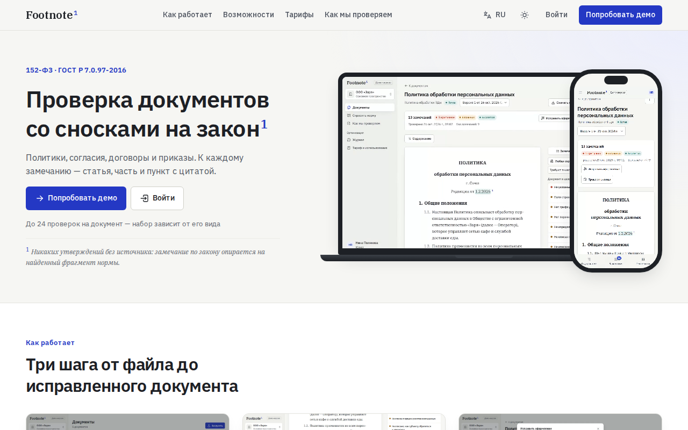 | 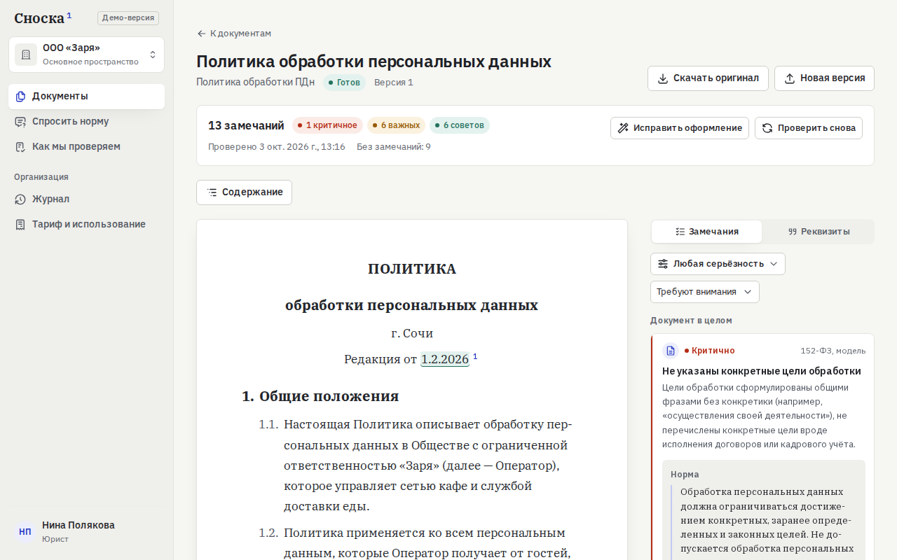 |
| Лендинг для гостей | Замечание по 152-ФЗ: цитата нормы и как исправить |
| 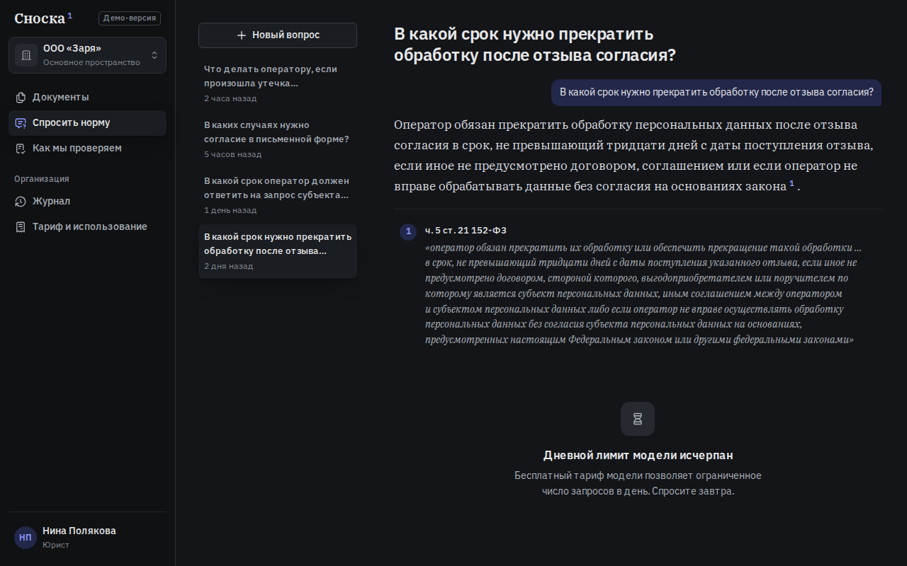 | 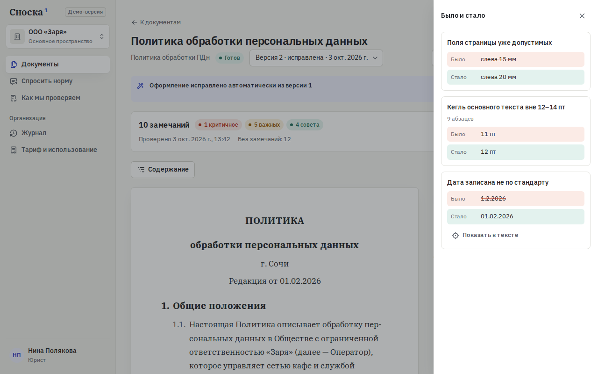 |
| «Спросить норму»: ответ с цитатой ч. 5 ст. 21 | Автоисправление оформления |
| 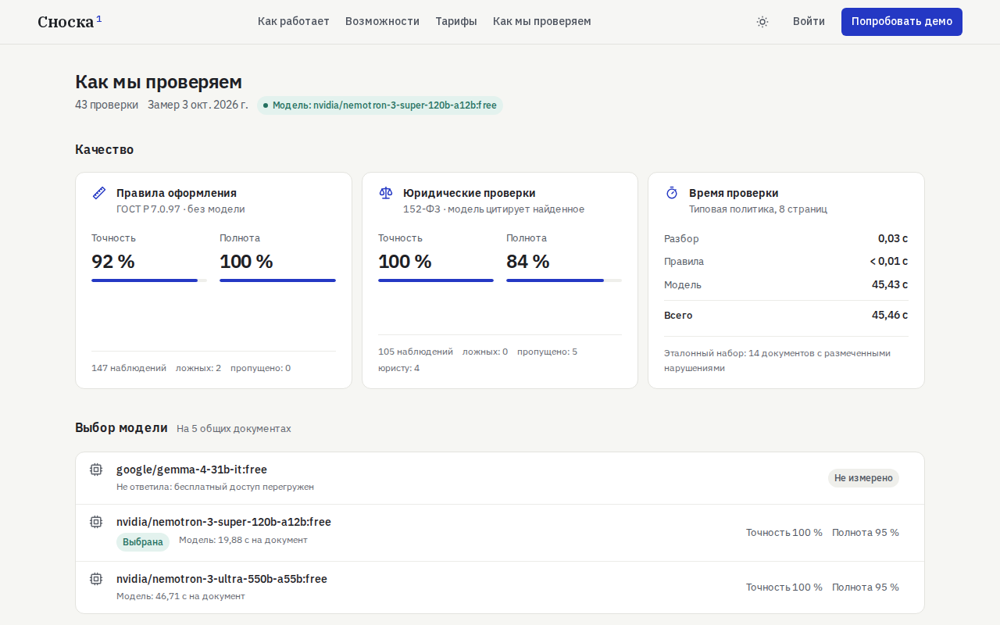 | 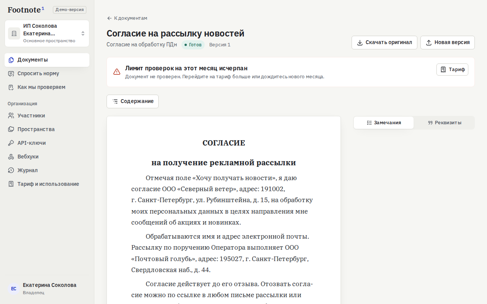 |
| Точность, полнота и выбор модели | Лимит тарифа исчерпан — честно и со ссылкой на тариф |

На телефоне:

| | | | |
| --- | --- | --- | --- |
| 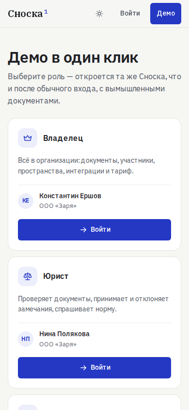 | 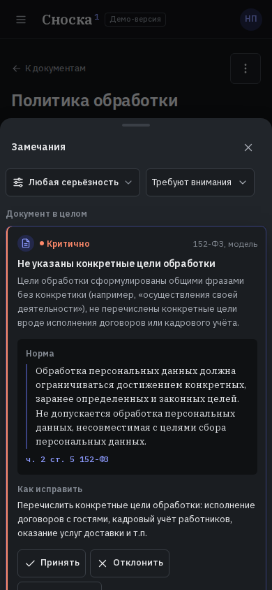 | 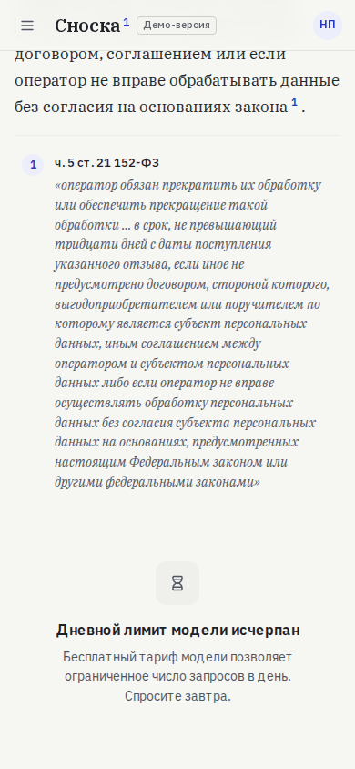 | 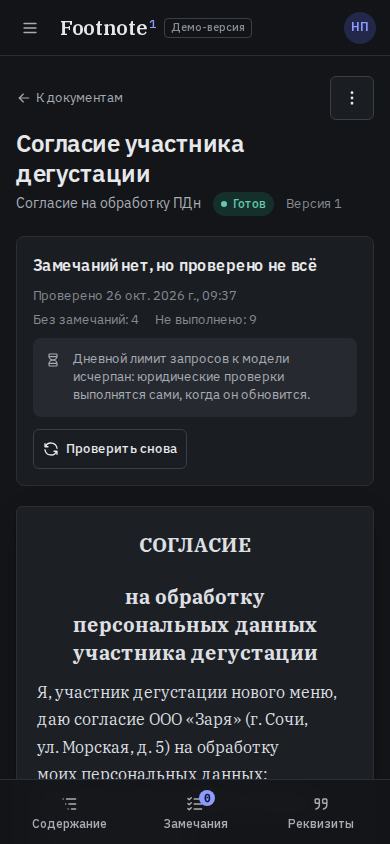 |
| Вход в один клик | Замечание с нормой | Ответ с цитатой | Ждёт лимита модели |

## Описание для карточки

**Коротко (до 300 знаков)**

Сноска — сервис проверки документов по 152-ФЗ и ГОСТ: к каждому замечанию — статья, часть и пункт закона с цитатой. Модель отвечает только с опорой на норму, оформление исправляется новой версией DOCX. Роли, тарифы, API и вебхуки, демо в один клик.

**Подробно (до 1500 знаков)**

Сноска проверяет политики, согласия, договоры поручения и приказы на соответствие 152-ФЗ «О персональных данных» и правилам оформления ГОСТ Р 7.0.97-2016. Результат выглядит как сам документ: в тексте — надстрочные номера, на полях — карточки с серьёзностью, цитатой нормы и рекомендацией. Каждое юридическое замечание опирается на дословную цитату из документа и положение закона из действующей редакции: ответ модели без такой опоры не принимается. Это не формальность — без контекста модель назвала срок прекращения обработки после отзыва согласия «три рабочих дня», а в законе тридцать дней.

43 проверки описаны данными; качество измерено на эталонном наборе: юридические — точность 100 %, полнота 84 %, оформление — полнота 100 %. Ошибки оформления исправляются автоматически новой версией DOCX с журналом «было/стало». «Спросить норму» отвечает о 152-ФЗ только с цитатами.

Вокруг проверки — сервис для команды: организации и роли, пространства, тарифы с лимитами и тестовой оплатой, API-ключи и подписанные вебхуки, журнал аудита, слежение за новыми редакциями закона, консоль оператора. Изоляция клиентов — на уровне базы (RLS). Бесплатный тариф модели учтён в дизайне: пачки запросов, кэш, дневной бюджет и честное ожидание вместо ошибки.

Стек: FastAPI, PostgreSQL с pgvector, Dramatiq, Next.js 16, Keycloak, Docker и Caddy.
