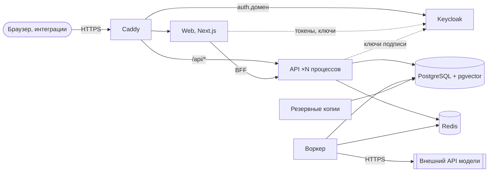

# Выкатка на сервер

Продакшен-сборка «Сноски» — один сервер с Docker Compose: [`docker-compose.prod.yml`](../docker-compose.prod.yml). Снаружи открыт только Caddy (80 и 443), он выпускает TLS-сертификаты Let's Encrypt сам; остальные сервисы общаются во внутренней сети.



| Сервис | Что делает |
| --- | --- |
| `caddy` | TLS, HTTP/3, обратный прокси; консоль администратора Keycloak снаружи закрыта |
| `web` | Next.js (standalone), BFF: токены остаются на сервере |
| `api` | FastAPI, `SNOSKA_API_WORKERS` процессов |
| `worker` | разбор документов, проверки, вебхуки, периодические задачи |
| `migrate` | миграции базы при каждой выкатке, до старта API и воркера |
| `keycloak` | вход, организации и роли; браузер ходит на `auth.домен`, серверы — на `keycloak:8080`; образ собирается заранее (`infra/keycloak/Dockerfile`): realm и тема входа внутри, `start --optimized` |
| `postgres`, `redis` | данные (RLS по тенантам) и очередь задач, сессии |
| `backup` | ночные копии обеих баз и файлов, хранятся 14 дней |
| `demo-reset` | только демо-стенд (профиль `demo`): ночной возврат к сиду |

Образы: `backend/Dockerfile` (один образ для API, воркера и команд; Python 3.13, Tesseract для сканов), `frontend/Dockerfile` (Node 24) и `infra/keycloak/Dockerfile` (Keycloak с зафиксированными параметрами сборки: PostgreSQL, проверка здоровья, без неиспользуемых возможностей — CIBA, device flow, PAR, Kerberos, impersonation). Оба многоступенчатые, процессы работают не от root (uid 10001), у каждого сервиса есть healthcheck. Журналы контейнеров ротируются: не больше 5 файлов по 10 МБ на сервис.

## Требования к серверу

| | Минимум | Рекомендуется |
| --- | --- | --- |
| CPU | 2 vCPU | 4 vCPU |
| Память | 4 ГБ | 8 ГБ |
| Диск | 30 ГБ SSD | 60 ГБ SSD |
| ОС | Ubuntu 24.04 LTS | Ubuntu 24.04 LTS |

Откуда цифры: стек в работе занимает около 1,5 ГБ памяти (замер локально: Keycloak 540 МБ, API с двумя процессами 400 МБ, воркер 150 МБ, PostgreSQL 100 МБ, web 100 МБ, остальное — десятки мегабайт); сборка образа web на сервере требует ещё около 2 ГБ; лимиты памяти сервисов в сумме — 6 ГБ. Диск: образы около 1,5 ГБ с базовыми слоями, база и файлы растут с документами, копии за 14 дней. Модели на сервере не работают — только внешний API.

### Маленький сервер

На сервере с 4 ГБ, который «Сноска» делит с другими сервисами, память и соединения задаются в `.env.prod`:

| Переменная | Значение | Зачем |
| --- | --- | --- |
| `SNOSKA_API_WORKERS` | `1` | один процесс API вместо двух |
| `SNOSKA_WORKER_THREADS` | `2` | воркер разбирает два документа одновременно; бесплатный тариф модели всё равно ограничивает темп |
| `SNOSKA_DB_POOL_SIZE`, `SNOSKA_DB_MAX_OVERFLOW` | `3`, `2` | до 5 соединений с PostgreSQL на процесс |
| `KEYCLOAK_HEAP_OPTIONS` | `-Xms64m -Xmx192m` | потолок кучи JVM вместо 70% лимита контейнера |
| `KEYCLOAK_JAVA_OPTIONS` | `-XX:TieredStopAtLevel=1 -Xss512k -XX:ReservedCodeCacheSize=64m -XX:MaxMetaspaceSize=192m` | только быстрый JIT, меньше памяти на стеки и код |
| `KEYCLOAK_DB_POOL_MAX_SIZE` | `8` | соединения Keycloak с базой |

Замер локально: Keycloak с этими настройками после импорта realm занимает около 370 МБ (с настройками по умолчанию — около 540 МБ). Keycloak всегда работает с локальным кэшем (`KC_CACHE=local`): один узел, без поиска соседей по кластеру.

### Одно имя: Keycloak под путём

Keycloak может жить не на своём имени, а под путём имени продукта, например
`https://snoska.example.ru/auth`. В `.env.prod`:

```bash
SNOSKA_KEYCLOAK_URL=https://snoska.example.ru/auth
KEYCLOAK_PATH=/auth
```

Образ Keycloak собирается с этим путём (`KEYCLOAK_HTTP_RELATIVE_PATH` — параметр сборки,
проверка здоровья на порту управления остаётся на `/health/ready`), серверы обращаются к
`http://keycloak:8080/auth`, а издатель токенов, адреса входа и выхода, redirect URI клиентов
из импорта realm (`${SNOSKA_WEB_URL}/auth/callback`) следуют за `SNOSKA_KEYCLOAK_URL` и
`SNOSKA_WEB_URL` сами. Прокси перед стеком отдаёт Keycloak только его публичные пути —
`/auth/realms/*` и `/auth/resources/*`; `/auth/login`, `/auth/callback`, `/auth/logout` и
`/auth/demo` — маршруты веб-приложения, консоль `/auth/admin` снаружи закрыта. Встроенный Caddy
этого файла настроен на отдельное имя Keycloak.

## Что нужно от владельца

- домен и две DNS-записи A (и AAAA, если есть IPv6) на сервер: `snoska.<домен>` и `auth.snoska.<домен>`;
- сервер с SSH-доступом по ключу;
- почтовый ящик для рассылки (SMTP с логином и паролем, STARTTLS): приглашения, сброс пароля, уведомления о новой редакции закона;
- ключ API модели и решение о тарифе: бесплатный — 50 запросов в день, юридические проверки сверх лимита ждут следующего дня; платный снимает ограничение;
- для приёма денег — договор с платёжным провайдером и его адаптер (сейчас подключён тестовый провайдер, деньги не списываются);
- e-mail для уведомлений Let's Encrypt.

## Выкатка на чистую Ubuntu 24.04

1. **Система и пользователь.**

   ```bash
   sudo apt update && sudo apt -y upgrade
   sudo adduser --disabled-password --gecos "" snoska && sudo usermod -aG sudo snoska
   sudo ufw allow OpenSSH && sudo ufw allow 80/tcp && sudo ufw allow 443/tcp && sudo ufw allow 443/udp
   sudo ufw enable
   ```

2. **Docker Engine и Compose** из репозитория Docker:

   ```bash
   sudo install -m 0755 -d /etc/apt/keyrings
   sudo curl -fsSL https://download.docker.com/linux/ubuntu/gpg -o /etc/apt/keyrings/docker.asc
   echo "deb [arch=$(dpkg --print-architecture) signed-by=/etc/apt/keyrings/docker.asc] \
     https://download.docker.com/linux/ubuntu $(. /etc/os-release && echo "$VERSION_CODENAME") stable" \
     | sudo tee /etc/apt/sources.list.d/docker.list > /dev/null
   sudo apt update && sudo apt -y install docker-ce docker-ce-cli containerd.io docker-buildx-plugin docker-compose-plugin
   sudo usermod -aG docker snoska
   ```

   Перезайти пользователем `snoska`.

3. **Код и конфигурация.**

   ```bash
   git clone <адрес репозитория> snoska && cd snoska
   cp infra/prod/env.example .env.prod && chmod 600 .env.prod
   ```

   Заполнить `.env.prod`: адреса, почту, ключ модели. Каждый секрет — случайный: `openssl rand -hex 32`. `SNOSKA_SECRETS_KEY` после первого запуска не меняется (иначе секреты вебхуков станут нечитаемыми). `SNOSKA_DEMO_MODE=false` для настоящей установки.

4. **Сборка и запуск.**

   ```bash
   docker compose -f docker-compose.prod.yml --env-file .env.prod up -d --build
   docker compose -f docker-compose.prod.yml --env-file .env.prod ps
   ```

   Все сервисы должны стать `healthy` (Keycloak — за 1–2 минуты при первом старте), `migrate` — завершиться с кодом 0. Caddy получит сертификаты, как только DNS указывает на сервер.

5. **Корпус норм и индекс.**

   ```bash
   alias snoska='docker compose -f docker-compose.prod.yml --env-file .env.prod run --rm api snoska'
   snoska corpus sync --source snapshot   # 152-ФЗ из поставки; раз в неделю воркер сверяет с официальным порталом
   snoska corpus reindex                  # эмбеддинги корпуса во внешнем API (центы)
   snoska checks benchmark                # необязательно: точность и время на эталонном наборе
   ```

6. **Оператор платформы и первая организация.**

   ```bash
   snoska tenants operator --email ops@<домен> --first-name Имя --last-name Фамилия   # пароль спросит
   snoska tenants create romashka --name "ООО «Ромашка»" --domain romashka.ru \
     --owner-email ivanova@romashka.ru --owner-first-name Мария --owner-last-name Иванова
   ```

   Владелец получит письмо-приглашение и задаст пароль; дальше участников приглашают из продукта. Тариф организации назначает оператор в разделе «Платформа».

7. **Проверка.** `https://snoska.<домен>` — лендинг; вход владельцем; загрузка документа доходит до результата проверки; `https://snoska.<домен>/api/health/ready` отвечает 200; `https://auth.snoska.<домен>/admin/` — 404 (консоль закрыта).

## Обновление

```bash
git pull
docker compose -f docker-compose.prod.yml --env-file .env.prod up -d --build
```

Миграции применяются сервисом `migrate` до старта новых API и воркера. Откат — `git checkout <тег>` и та же команда; миграции пишутся совместимыми с предыдущей версией кода.

### Английский интерфейс (миграция 0013)

Тексты, которые продукт пишет для читателя, хранятся на всех языках интерфейса. Миграция 0013 оставляет прежним строкам их русский текст; английский появляется после перепроверки и синхронизации корпуса. Realm, импортированный раньше, Keycloak не перечитывает — языки, тему писем и адрес возврата из приглашения добавляют один раз:

```bash
snoska corpus sync --source pravo_ips     # названия актов на всех языках (или дождаться еженедельной проверки)
snoska checks recheck                     # последние версии документов — с текстами на всех языках
C="docker compose -f docker-compose.prod.yml --env-file .env.prod"
# пароль администратора Keycloak спросят; к адресу добавить KEYCLOAK_PATH, если он задан
$C exec -it keycloak /opt/keycloak/bin/kcadm.sh config credentials \
  --server http://localhost:8080 --realm master --user admin
$C exec keycloak /opt/keycloak/bin/kcadm.sh update realms/snoska \
  -s 'supportedLocales=["en","ru"]' -s defaultLocale=en -s emailTheme=snoska
# В клиенте snoska-web к Valid redirect URIs добавить адрес веба без пути: https://домен
```

Перепроверка юридических проверок тратит запросы к модели (на документ — один запрос на 12 проверок); на бесплатном тарифе её лучше запускать в начале суток по UTC. Записи лендинга для каждого языка лежат в `frontend/public/landing/<язык>/` и снимаются `make demo-refresh`.

## Резервные копии

Сервис `backup` каждую ночь (`SNOSKA_BACKUP_HOUR`, по UTC) кладёт в `SNOSKA_BACKUP_DIR` каталог с `snoska.dump`, `keycloak.dump` (pg_dump, формат custom) и `blobs.tar.gz` (загруженные файлы) и удаляет копии старше `SNOSKA_BACKUP_KEEP_DAYS`. Копию вне расписания: `docker compose -f docker-compose.prod.yml --env-file .env.prod exec backup /usr/local/bin/backup.sh now`. Каталог копий стоит синхронизировать за пределы сервера (rclone, rsync).

Восстановление — в пустые базы, объекты создаются от ролей-владельцев, права роли приложения и политики RLS приходят из дампа:

```bash
C="docker compose -f docker-compose.prod.yml --env-file .env.prod"
D=backups/<дата>
$C stop api worker web keycloak
$C exec -T postgres psql -U postgres \
  -c 'DROP DATABASE snoska WITH (FORCE)' -c 'CREATE DATABASE snoska OWNER snoska_owner' \
  -c 'DROP DATABASE keycloak WITH (FORCE)' -c 'CREATE DATABASE keycloak OWNER keycloak'
$C exec -T postgres psql -U postgres -d snoska -c 'CREATE EXTENSION vector'
$C exec -T postgres pg_restore -U postgres --role=snoska_owner --no-owner --no-comments -d snoska < $D/snoska.dump
$C exec -T postgres pg_restore -U postgres --role=keycloak --no-owner --no-comments -d keycloak < $D/keycloak.dump
$C run --rm --entrypoint sh -v "$PWD/$D:/restore:ro" worker -c 'tar -xzf /restore/blobs.tar.gz -C /app/var/blobs'
$C up -d
```

Проверено локально: дамп разворачивается в пустую базу без ошибок, таблицы принадлежат `snoska_owner`, у `snoska_app` есть права, RLS включена.

## Демо-стенд

То же самое с `SNOSKA_DEMO_MODE=true` и профилем `demo`: вход в один клик по ролям, защищённые демо-учётные записи и ночной сброс к сиду (`SNOSKA_DEMO_RESET_HOUR`, по Москве).

```bash
docker compose -f docker-compose.prod.yml --env-file .env.prod --profile demo up -d --build
snoska demo seed
```

## Проверено локально

Сборка запускалась целиком на этой машине без настоящего деплоя: `SNOSKA_DOMAIN=localhost`, `SNOSKA_AUTH_DOMAIN=auth.localhost`, порты 46380 и 46381 (TLS от локального центра Caddy), демо-режим. Проверено: все сервисы `healthy`, миграции и сид, лендинг, вход в один клик и обычный вход через Keycloak по HTTPS, выход, документ с результатом проверки, публичный API через Caddy, закрытая консоль Keycloak, резервная копия и её восстановление в отдельную базу (с ролью-владельцем — на базе разработки).
